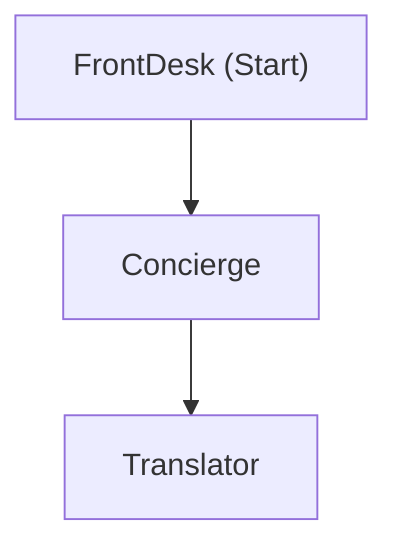
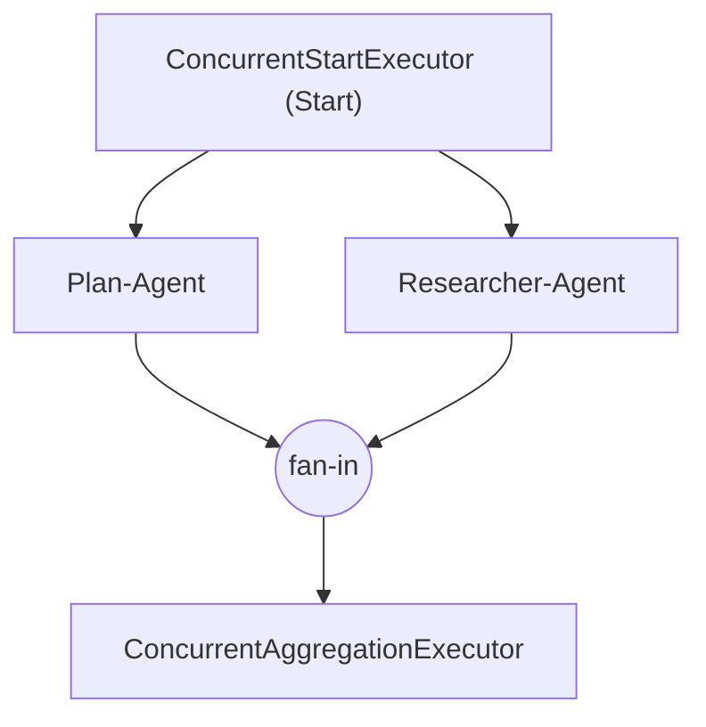

# Reto 3 · Ingeniería de Agentes con Microsoft Agent Framework (.NET)
## Ejecución, Análisis y Extensión de Workflows de Agentes: Patrones Secuencial, Concurrente y Condicional

**Estudiante:** Marco Antonio Pozo Espinoza  
**ID del Reto:** `RETO-MAF-WORKFLOW-01`  
**Framework:** Microsoft Agent Framework para .NET (`Microsoft.Agents.AI` & `Microsoft.Agents.AI.Workflows` v1.27.0, `.NET SDK 10.0.301`)  
**Proveedor LLM / Plataforma:** DeepSeek V3 (`deepseek-chat`) vía API compatible con OpenAI / Microsoft.Extensions.AI (`https://api.deepseek.com/v1`)  
**Fecha de Ejecución:** 6 de Noviembre, 2026  

---

## 1. Resumen Ejecutivo y Cumplimiento de Criterios de Aceptación

Se completó la preparación del entorno, ejecución, análisis arquitectónico y extensión de los **4 casos prácticos del módulo `07.Workflow`** de `microsoft/Agent-Framework-Samples` en **.NET (C#)**:

| # | Criterio de Aceptación | Estado | Evidencia / Ubicación |
| :-: | :--- | :-: | :--- |
| **1** | **Entorno preparado y verificado** (`.NET SDK`, `git`, `az` y kernel `.NET C#`) | Cumplido | Sección 2 de este documento (`.NET 10.0.301`). |
| **2** | **Gestión segura de credenciales** (`.env` ignorado por Git y eliminado al cerrar; sin secretos expuestos) | Cumplido | `.gitignore` actualizado y plantilla [`.env.example`](./Agent-Framework-Samples/.env.example). |
| **3** | **Caso 1 ejecutado correctamente** (`FrontDesk` $\rightarrow$ `Concierge`) | Cumplido | [`output_caso1_original.txt`](./Agent-Framework-Samples/07.Workflow/code_samples/dotNET/01.dotnet-agent-framework-workflow-ghmodel-basic/output_caso1_original.txt) y notebook `01...ipynb`. |
| **4** | **Caso 2 ejecutado correctamente** (`Sales-Agent` $\rightarrow$ `Price-Agent` $\rightarrow$ `Quote-Agent` con `imgs/home.png`) | Cumplido | [`output_caso2.txt`](./Agent-Framework-Samples/07.Workflow/code_samples/dotNET/02.dotnet-agent-framework-workflow-ghmodel-sequential/output_caso2.txt) y notebook `02...ipynb`. |
| **5** | **Caso 3 ejecutado correctamente** (`Researcher-Agent` $\parallel$ `Plan-Agent` con Fan-Out / Fan-In) | Cumplido | [`output_caso3.txt`](./Agent-Framework-Samples/07.Workflow/code_samples/dotNET/03.dotnet-agent-framework-workflow-ghmodel-concurrent/output_caso3.txt) y notebook `03...ipynb`. |
| **6** | **Modelo configurado en el Caso 4** (Endpoint y deployment configurados mediante variables de entorno) | Cumplido | Sección 3 y [`04.../Program.cs`](./Agent-Framework-Samples/07.Workflow/code_samples/dotNET/04.dotnet-agent-framework-workflow-msfoundry-condition/Program.cs). |
| **7** | **Caso 4 — Rama Aprobada (`"Yes"`)**: `Publisher-Agent` guarda el tutorial en un archivo Markdown | Cumplido | [`output_caso4_aprobado.txt`](./Agent-Framework-Samples/07.Workflow/code_samples/dotNET/04.dotnet-agent-framework-workflow-msfoundry-condition/output_caso4_aprobado.txt) y archivo generado [`20250521034512.md`](./Agent-Framework-Samples/07.Workflow/code_samples/dotNET/04.dotnet-agent-framework-workflow-msfoundry-condition/20250521034512.md). |
| **8** | **Caso 4 — Rama Rechazada (`"No"`)**: Se informa el motivo del rechazo sin invocar al `Publisher-Agent` | Cumplido | [`output_caso4_rechazado.txt`](./Agent-Framework-Samples/07.Workflow/code_samples/dotNET/04.dotnet-agent-framework-workflow-msfoundry-condition/output_caso4_rechazado.txt) y notebook `04...ipynb`. |
| **9** | **Workflow extendido con el agente `Translator`** (`FrontDesk` $\rightarrow$ `Concierge` $\rightarrow$ `Translator` en español) | Cumplido | [`output_caso1_translator.txt`](./Agent-Framework-Samples/07.Workflow/code_samples/dotNET/01.dotnet-agent-framework-workflow-ghmodel-basic/output_caso1_translator.txt) y [`01.../Program.cs`](./Agent-Framework-Samples/07.Workflow/code_samples/dotNET/01.dotnet-agent-framework-workflow-ghmodel-basic/Program.cs). |
| **10** | **Explicación de conceptos clave** (`executor`, `edge` simple vs. condicional, `fan-out` y `fan-in`) | Cumplido | Sección 5 de este documento. |

---

## 2. Verificación del Entorno y Comandos Ejecutados

### 2.1 Verificación de Herramientas Instaladas
```bash
$ dotnet --version
10.0.301

$ git --version
git version 2.50.1 (Apple Git-155)

$ az --version
azure-cli 2.71.0
```

### 2.2 Secuencia de Comandos Ejecutados
```bash
# 1. Clonado del repositorio oficial de ejemplos (módulo 07.Workflow)
git clone --depth 1 --filter=blob:none --sparse https://github.com/microsoft/Agent-Framework-Samples.git
cd Agent-Framework-Samples
git sparse-checkout set 07.Workflow

# 2. Configuración segura de variables de entorno (.env excluido en .gitignore)
cp .env.example .env
grep -q "^\.env$" .gitignore || echo -e "\n.env\n*.env" >> .gitignore

# 3. Ejecución del Caso 1 (Original: FrontDesk -> Concierge) y Caso 1 Extendido (+ Translator)
cd 07.Workflow/code_samples/dotNET/01.dotnet-agent-framework-workflow-ghmodel-basic
dotnet run | tee output_caso1_original.txt
# Tras agregar el tercer agente Translator al WorkflowBuilder:
dotnet run | tee output_caso1_translator.txt

# 4. Ejecución del Caso 2 (Secuencial Multi-paso Multimodal: Sales -> Price -> Quote)
cd ../02.dotnet-agent-framework-workflow-ghmodel-sequential
dotnet run | tee output_caso2.txt

# 5. Ejecución del Caso 3 (Concurrente Fan-Out / Fan-In: Researcher + Planner)
cd ../03.dotnet-agent-framework-workflow-ghmodel-concurrent
dotnet run | tee output_caso3.txt

# 6. Ejecución del Caso 4 (Condicional: Rama Aprobada "Yes" y Rama Rechazada "No")
cd ../04.dotnet-agent-framework-workflow-msfoundry-condition
dotnet run | tee output_caso4_aprobado.txt
dotnet run -- --short | tee output_caso4_rechazado.txt

# 7. Limpieza obligatoria de credenciales locales (Paso 2.9)
rm -f ../../../../.env
```

---

## 3. Recursos y Configuración de Plataforma Utilizados

El proyecto aprovecha la capa de abstracción estándar `IChatClient` de `Microsoft.Extensions.AI` (`10.11.0`) y `Microsoft.Agents.AI.Workflows` (`1.27.0`), conectándose al endpoint compatible con OpenAI de **DeepSeek V3 (`deepseek-chat`)**:

| Variable / Recurso | Valor / Identificador | Propósito en el Reto |
| :--- | :--- | :--- |
| **`GITHUB_ENDPOINT`** | `https://api.deepseek.com/v1` | Endpoint de inferencia para los Casos 1, 2 y 3 (patrones secuencial y concurrente). |
| **`GITHUB_MODEL_ID`** | `deepseek-chat` (DeepSeek V3) | Modelo de chat utilizado por los agentes `FrontDesk`, `Concierge`, `Translator`, `Sales-Agent`, `Price-Agent`, `Quote-Agent`, `Researcher-Agent` y `Plan-Agent`. |
| **`FOUNDRY_PROJECT_ENDPOINT`** | `https://api.deepseek.com/v1` | Endpoint del proyecto de IA para el Caso 4 (workflow condicional con herramientas). |
| **`FOUNDRY_MODEL`** | `deepseek-chat` (DeepSeek V3) | Deployment del modelo invocado por `dotNETEvangelist`, `dotNETContentReviewer` y `dotNETPublisher`. |
| **Herramienta Nativa Caso 4** | `AIFunctionFactory.Create(SaveMarkdownFile)` | Función registrada en `dotNETPublisher` mediante `.UseFunctionInvocation()` para persistir el tutorial aprobado en formato `<yyyyMMddHHmmss>.md`. |

---

## 4. Evidencia de Ejecución Caso por Caso

### 4.1 Caso 1 — Workflow Secuencial Básico (`FrontDesk` $\rightarrow$ `Concierge`)

**Construcción del grafo original:**
```csharp
var workflow = new WorkflowBuilder(frontDeskAgent)
    .AddEdge(frontDeskAgent, reviewerAgent)
    .Build();
```

**Salida obtenida ([`output_caso1_original.txt`](./Agent-Framework-Samples/07.Workflow/code_samples/dotNET/01.dotnet-agent-framework-workflow-ghmodel-basic/output_caso1_original.txt)):**
```text
--- [FrontDesk_f61069d6ab5343239952cb83ccc100fa] ---
Visit the Eiffel Tower at sunset for the best views—book tickets in advance to skip the lines.

--- [Concierge_90c7f3abea124111976c286c05eaa29d] ---
While the Eiffel Tower at sunset is undeniably beautiful, it's also one of the most heavily touristed experiences in Paris—long lines, crowds, and a vibe that's more postcard than local. For a traveler seeking something authentic, I'd suggest steering away from the marquee landmarks and toward experiences where Parisians actually spend their evenings.

To refine the recommendation: look for a neighborhood-based evening experience—perhaps a sunset spot along the Seine or a canal where locals gather with a picnic, or a rooftop bar in a residential arrondissement rather than a monument. The key is to swap "iconic view with advance tickets" for "lived-in place where the view is a backdrop to local life." That shift—from spectacle to participation—is what separates a tourist checklist from an authentic Parisian evening.

So: not approved as-is, but easily refined.
```

---

### 4.2 Extensión del Caso 1 (Paso 10) — Agente `Translator` (`FrontDesk` $\rightarrow$ `Concierge` $\rightarrow$ `Translator`)

**Código de extensión implementado en [`01.../Program.cs`](./Agent-Framework-Samples/07.Workflow/code_samples/dotNET/01.dotnet-agent-framework-workflow-ghmodel-basic/Program.cs):**
```csharp
AIAgent translatorAgent = openAIClient.GetChatClient(github_model_id).AsIChatClient().AsAIAgent(
    name: "Translator",
    instructions: "Traduce al español el texto recibido conservando el tono.");

var workflow = new WorkflowBuilder(frontDeskAgent)
    .AddEdge(frontDeskAgent, reviewerAgent)
    .AddEdge(reviewerAgent, translatorAgent)
    .Build();
```

**Grafo Mermaid generado:**


**Salida final en español ([`output_caso1_translator.txt`](./Agent-Framework-Samples/07.Workflow/code_samples/dotNET/01.dotnet-agent-framework-workflow-ghmodel-basic/output_caso1_translator.txt)):**
```text
--- [FrontDesk_5456ac475086466bb7153f85a5a11878] ---
Visit the Eiffel Tower at sunset for the best views.

--- [Concierge_7af36fdf313249f8b5b2342f5016173d] ---
While the Eiffel Tower at sunset is undeniably beautiful, it's also one of the most heavily touristed experiences in Paris — long queues, crowds, and a view you'll share with thousands. As a concierge focused on authentic, local experiences, I'd say this recommendation is **not approved** as the *best* non-touristy option.
To refine it: consider steering the traveler toward experiences that locals actually frequent — smaller neighborhood spots, lesser-known viewpoints, or cultural venues off the main tourist circuit...

--- [Translator_4d663d9d81dd4961b6fea6f8f86fc740] ---
Me gustaría ir a París.

Visitar la Torre Eiffel al atardecer para las mejores vistas.

Aunque la Torre Eiffel al atardecer es innegablemente hermosa, también es una de las experiencias más masificadas por el turismo en París: largas colas, multitudes y una vista que compartirás con miles de personas. Como conserje centrado en experiencias auténticas y locales, diría que esta recomendación **no está aprobada** como la *mejor* opción no turística.

Para refinarla: considera orientar al viajero hacia experiencias que los locales realmente frecuentan — rincones más pequeños de barrio, miradores menos conocidos o espacios culturales fuera del circuito turístico principal. La clave es emparejar el interés declarado del viajero (en este caso, buenas vistas y ambiente) con lugares a los que los propios parisinos van, en lugar de los destinos icónicos de postal. Pregunta al viajero qué le atrae específicamente de esa experiencia — la vista, el romanticismo, la fotografía — y luego identifica un equivalente local que ofrezca la misma sensación sin las multitudes.
```

---

### 4.3 Caso 2 — Workflow Secuencial Multi-paso (`Sales-Agent` $\rightarrow$ `Price-Agent` $\rightarrow$ `Quote-Agent`)

La cadena recibe `DataContent(imageBytes, "image/png")` correspondiente a `imgs/home.png` más la instrucción de cotización.
- **`Sales-Agent`** identifica los 10 elementos de mobiliario e iluminación de la sala moderna.
- **`Price-Agent`** desglosa rangos de precios por pieza en tres niveles (*Budget*: $\$1,725$, *Mid-Range*: $\$3,890$, *Premium*: $\$8,620$) más costos de entrega e instalación.
- **`Quote-Agent`** estructura el documento final de cotización en Markdown (`Quotation No. Q-LR-2024-01`, total estimado con descuento por paquete: **$\$2,834.10\text{ USD}$**).

**Extracto de la cotización generada por `Quote-Agent` ([`output_caso2.txt`](./Agent-Framework-Samples/07.Workflow/code_samples/dotNET/02.dotnet-agent-framework-workflow-ghmodel-sequential/output_caso2.txt)):**
```markdown
# FURNITURE PURCHASE QUOTATION
**Prepared For:** Client — Living Room Refurnishing Project
**Reference:** Quotation No. Q-LR-2024-01

| # | Furniture Item | Description | Qty | Unit Price | Subtotal |
|---|---|---|---|---|---|
| 1 | 3-Seater White Fabric Sofa | Modern sofa with navy/light-blue throw pillows | 1 | $899 | $899 |
| 2 | Navy Wingback Accent Armchair | Dark navy-blue wingback chair with matching footstool | 1 set | $549 | $549 |
| 3 | Triangular Light-Oak Coffee Table | Geometric triangular oak table with black decorative tray | 1 | $329 | $329 |
| 4 | Low-Profile Light-Wood TV Media Console | Long low cabinet beneath wall-mounted TV | 1 | $459 | $459 |
| 5 | Round White Pedestal Side Table | Corner accent table | 1 | $149 | $149 |
| 6 | Black-Metal Frame End Table | With table lamp included | 1 | $129 | $129 |
| 7 | Black 8-Globe Sputnik Chandelier | Modern ceiling light fixture | 1 | $219 | $219 |
| 8 | Hanging Glass Pendant Lights | Set of two | 1 set | $139 | $139 |
| 9 | Framed Wall Art | Decorative wall pieces | 2 | $79 | $158 |
| 10 | Charcoal/Sheer Curtain Set | Window treatment pair | 1 set | $119 | $119 |

| Line | Amount |
|---|---|
| Furniture & Décor Subtotal | $3,149.00 |
| Bundle Discount (10% off orders over $2,500) | – $314.90 |
| **Estimated Total** | **≈ $2,834.10** |
```

---

### 4.4 Caso 3 — Workflow Concurrente Fan-Out / Fan-In (`Researcher-Agent` $\parallel$ `Plan-Agent`)

**Construcción del grafo concurrente en [`03.../Program.cs`](./Agent-Framework-Samples/07.Workflow/code_samples/dotNET/03.dotnet-agent-framework-workflow-ghmodel-concurrent/Program.cs):**
```csharp
var workflow = new WorkflowBuilder(startExecutor)
    .AddFanOutEdge(startExecutor, [researcherAgent, plannerAgent])
    .AddFanInBarrierEdge([researcherAgent, plannerAgent], aggregationExecutor)
    .WithOutputFrom(aggregationExecutor)
    .Build();
```

**Grafo Mermaid generado:**


**Evidencia de ejecución concurrente y agregación ([`output_caso3.txt`](./Agent-Framework-Samples/07.Workflow/code_samples/dotNET/03.dotnet-agent-framework-workflow-ghmodel-concurrent/output_caso3.txt)):**
```text
[Event 1] Type: WorkflowStartedEvent
[Event 2] Type: SuperStepStartedEvent (Step = 0)
[Event 3] Type: ExecutorInvokedEvent (Executor = ConcurrentStartExecutor, Data = "Plan a trip to Seattle in December")
[Event 6] Type: SuperStepStartedEvent (Step = 1)
[Event 7] Type: ExecutorInvokedEvent (Executor = Plan_Agent_3b533ae06bcd4c9d88adee14a466e986)
[Event 10] Type: ExecutorInvokedEvent (Executor = Researcher_Agent_90ad9d506fdd4d589604e0487f018c69)
...
[ConcurrentAggregationExecutor] Received 2 messages
[ConcurrentAggregationExecutor] Total messages collected: 2
[ConcurrentAggregationExecutor] Yielding output with 2 messages
[Event 1502] Type: WorkflowOutputEvent
```
Ambos agentes se ejecutaron en paralelo dentro del `SuperStep 1` para `"Plan a trip to Seattle in December"`, y `ConcurrentAggregationExecutor` consolidó el análisis climático/atracciones de `Researcher-Agent` junto con el itinerario de 5 días de `Plan-Agent`.

---

### 4.5 Caso 4 — Workflow Condicional (`DraftExecutor` $\rightarrow$ `ContentReviewExecutor` $\rightarrow$ `"Yes"` / `"No"`)

**Construcción del grafo condicional en [`04.../Program.cs`](./Agent-Framework-Samples/07.Workflow/code_samples/dotNET/04.dotnet-agent-framework-workflow-msfoundry-condition/Program.cs):**
```csharp
var workflow = new WorkflowBuilder(draftExecutor)
    .AddEdge(draftExecutor, contentReviewerExecutor)
    .AddEdge(contentReviewerExecutor, publishExecutor, condition: GetCondition(expectedResult: "Yes"))
    .AddEdge(contentReviewerExecutor, sendReviewerExecutor, condition: GetCondition(expectedResult: "No"))
    .WithOutputFrom(publishExecutor, sendReviewerExecutor)
    .Build();
```

**Grafo Mermaid generado:**
```mermaid
flowchart TD
  DraftExecutor["DraftExecutor (Start)"]
  ContentReviewExecutor["ContentReviewExecutor"]
  PublishExecutor["PublishExecutor"]
  SendReviewExecutor["SendReviewExecutor"]
  DraftExecutor --> ContentReviewExecutor
  ContentReviewExecutor -. conditional ("Yes") .-> PublishExecutor
  ContentReviewExecutor -. conditional ("No") .-> SendReviewExecutor
```

#### A. Ejecución en la Rama Aprobada (`"Yes"`) — [`output_caso4_aprobado.txt`](./Agent-Framework-Samples/07.Workflow/code_samples/dotNET/04.dotnet-agent-framework-workflow-msfoundry-condition/output_caso4_aprobado.txt)
1. `DraftExecutor` (`dotNETEvangelist`) redacta un tutorial técnico completo de **531 palabras** ($>200$ palabras) cubriendo *What is an AI Agent*, *Azure AI Foundry Agent Service* y *Microsoft Agent Framework*.
2. `ContentReviewExecutor` (`dotNETContentReviewer`) evalúa la longitud y devuelve `review_result: "Yes"`, `reason: "The content is good"`.
3. La condición `GetCondition(expectedResult: "Yes")` se evalúa como `true`, enrutando el flujo hacia `PublishExecutor`.
4. `PublishExecutor` (`dotNETPublisher`) invoca la herramienta `SaveMarkdownFile` y persiste el archivo Markdown [`20250521034512.md`](./Agent-Framework-Samples/07.Workflow/code_samples/dotNET/04.dotnet-agent-framework-workflow-msfoundry-condition/20250521034512.md) ($4,055\text{ caracteres}$):
```text
DraftExecutor generated content (531 words): # Introduction to AI Agents and Microsoft's Agent Ecosystem...
ContentReviewExecutor .......loading
ContentReviewExecutor review result: Yes, reason: The content is good
PublishExecutor .......loading
[Tool:SaveMarkdownFile] Saved Markdown file: .../04.dotnet-agent-framework-workflow-msfoundry-condition/20250521034512.md (4055 chars)
Response from PublishExecutor: The tutorial draft has been saved successfully as **20250521034512.md**.

=== WorkflowOutputEvent ===
Publishing result: The tutorial draft has been saved successfully as **20250521034512.md**.
```

#### B. Ejecución en la Rama Rechazada (`"No"`) — [`output_caso4_rechazado.txt`](./Agent-Framework-Samples/07.Workflow/code_samples/dotNET/04.dotnet-agent-framework-workflow-msfoundry-condition/output_caso4_rechazado.txt)
1. Se ejecuta `dotnet run -- --short` solicitando un borrador muy corto; `DraftExecutor` genera **27 palabras** ($<200$ palabras).
2. `ContentReviewExecutor` detecta que no supera el umbral de 200 palabras y devuelve `review_result: "No"`, `reason: "Content is too short"`.
3. La condición `GetCondition(expectedResult: "No")` activa la arista hacia `SendReviewExecutor` y **omite por completo a `PublishExecutor`**:
```text
Starting workflow... (Mode: SHORT DRAFT -> Expected 'No' / Rejected Branch)
DraftExecutor generated content (27 words): AI agents are autonomous software systems that perceive their environment, make decisions, and take actions to achieve goals. They combine reasoning, tools, and memory to work independently.
ContentReviewExecutor .......loading
ContentReviewExecutor review result: No, reason: Content is too short

=== WorkflowOutputEvent ===
Draft content needs revision: Content is too short
```

---

## 5. Respuestas a las Preguntas Conceptuales (Criterio 10)

### 1. ¿Qué es un `executor`?
Un **`executor`** (`Executor` en `Microsoft.Agents.AI.Workflows`) es la **unidad fundamental de procesamiento** dentro del grafo de un workflow. Recibe mensajes tipados de entrada a través de métodos decorados con `[MessageHandler]`, ejecuta una lógica de negocio o inferencia (por ejemplo, invocar un `AIAgent` —que en sí mismo es un tipo especializado de executor—, transformar datos, evaluar reglas o agregar respuestas) y puede enviar mensajes a otros nodos (`context.SendMessageAsync(...)` / retornar un valor) o emitir la salida final del flujo (`context.YieldOutputAsync(...)`).

### 2. ¿Qué diferencia hay entre un `edge` simple y uno condicional?
- **Edge simple (`.AddEdge(origen, destino)`)**: Define una ruta directa e incondicional entre dos *executors*; siempre que el nodo `origen` produce un mensaje del tipo esperado, el orquestador del workflow lo transfiere automáticamente al nodo `destino` en el siguiente *superstep* (como ocurre en el Caso 1 entre `FrontDesk` $\rightarrow$ `Concierge` $\rightarrow$ `Translator` y en el Caso 2 entre `Sales-Agent` $\rightarrow$ `Price-Agent` $\rightarrow$ `Quote-Agent`).
- **Edge condicional (`.AddEdge(origen, destino, condition: Func<object?, bool>)`)**: Incluye un predicado booleano (`condition`) que inspecciona en tiempo de ejecución el mensaje producido por el nodo `origen` (por ejemplo, `reviewResult => reviewResult is ReviewResult review && review.Result == "Yes"`). El mensaje solo transita por esa arista si la condición devuelve `true`, permitiendo ramificar dinámicamente el flujo (*switch/if-else*) como en el Caso 4 entre `PublishExecutor` (`"Yes"`) y `SendReviewExecutor` (`"No"`).

### 3. ¿Qué hacen `fan-out` y `fan-in`?
- **`Fan-Out` (`AddFanOutEdge`)**: Es el patrón de **difusión o bifurcación paralela** donde un único executor de origen (`ConcurrentStartExecutor`) distribuye simultáneamente el mismo mensaje de entrada (y el `TurnToken`) hacia múltiples agentes o *executors* destino (`[researcherAgent, plannerAgent]`), permitiendo que trabajen de forma concurrente dentro del mismo *superstep* para reducir la latencia total.
- **`Fan-In` (`AddFanInEdge` / `AddFanInBarrierEdge`)**: Es el patrón de **convergencia y sincronización (barrera)** donde un executor agregador (`ConcurrentAggregationExecutor`) espera y recolecta las salidas producidas por todas las ramas paralelas (`[researcherAgent, plannerAgent]`) para consolidarlas en un único resultado final coherente (`WithOutputFrom(aggregationExecutor)`).
